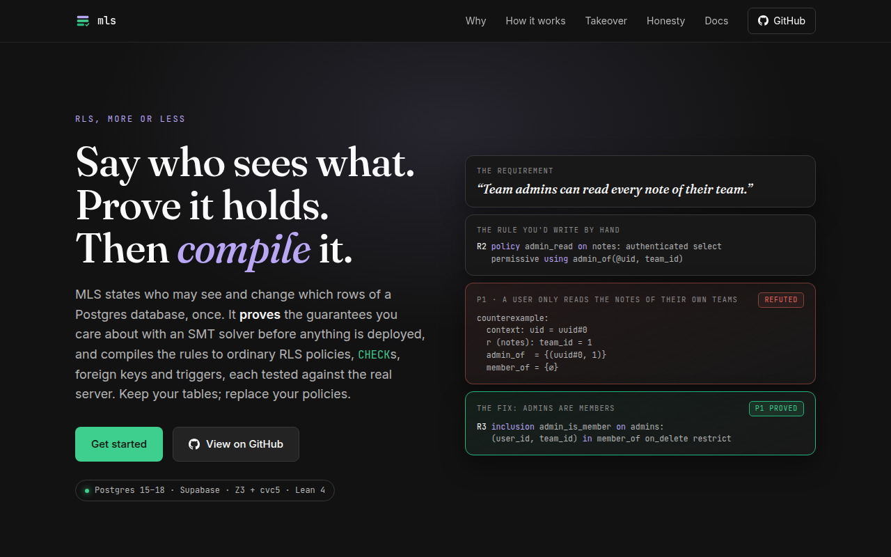

# MLS — "More LS": RLS more-or-less

**[→ Explainer page](https://neptunestation-com.github.io/more_ls/)**

[](https://neptunestation-com.github.io/more_ls/)

A specification language and verified compiler for PostgreSQL **row-level security** and
data-integrity rules. You state who may see and change which rows, once. MLS **proves** the
guarantees you care about with an SMT solver before anything is deployed, then compiles the rules
to ordinary Postgres objects, each one differential-tested against the real server. Keep your
tables; replace your policies.

A spec is a `.mls` file (one line per rule) or the equivalent JSON, and the `mls` tool takes it
through the whole lifecycle:

- **`check`**: JSON shape, column types, and that every predicate stays inside the fragment the
  prover and the compiler support.
- **`prove`**: tenant isolation, immutable columns, monotonicity in membership, write ⊆ read,
  least privilege, inductive invariants, role separation, custom upper bounds, and `must_allow`
  lower bounds, on SQL's three-valued logic. A failed proof comes with a **counterexample**: a
  concrete database small enough to read aloud. Exit code 2 when anything is refuted.
- **`compile`**: one SQL script of RLS policies, `CHECK ((p) IS TRUE)` constraints, composite
  foreign keys, triggers from fixed templates, column privileges, indexes, grants and hardening.
  Membership always compiles to the one policy shape Postgres runs once per statement and drives
  from an index (`col = any(array(select ...))`): 0.23 ms on a million rows where the usual
  hand-written `IN (select ...)` takes 71 ms.
- **`test`**: the differential test of the compiled objects against MLS's own evaluator, on
  Postgres 15–18 in Docker.
- **`import`**: a spec from a live database. `--policies discard` keeps the tables, keys and
  readable `CHECK`s and drops the hand-written policies, for the
  [takeover](docs/GUIDE.md#3-taking-over-the-schema-you-have); the default lifts the policies into the verified fragment.
- **`diff`**, **`migrate`**, **`preflight`**, **`drift`**: every change in effect between two
  specs, with an example row; a phased migration with its lock levels; the existing rows a new
  constraint would reject; the live catalog against what the spec deploys.
- **`explain`**, **`status`**, **`lint`**: the rules and properties in plain English (the approval
  artifact); proved / refuted / opaque per table; dead, redundant and slow rules.
- **`generate`**: an LLM writes the rules and properties from requirement sentences, and any
  relation the schema lacks, and repairs them against the prover until they hold.

The intended workflow: an LLM writes the spec from business requirements, and a human approves
the *properties* and the *scenarios* in plain English. Nobody has to read MLS or DDL to approve a
change, though both are there to be read.

Two caveats, both covered in the [guide](docs/GUIDE.md#15-limits-and-things-mls-refuses-to-do).
The language is **small on purpose**: membership, comparisons with the current user or constants,
hierarchies with a declared depth, time windows and column rules, with no joins, arithmetic or
functions in predicates. That is what keeps every proof decidable. Anything else goes in an explicit
`opaque` block, and every proof that needs one is reported as conditional on it, by name. And the
proofs are about the model: **trusted roles** (superusers, `BYPASSRLS`, Supabase's `service_role`)
bypass everything, and views or `SECURITY DEFINER` functions that reach a table without its
policies are reported as bypass paths, never rewritten. Every proof report states its assumptions.

## Why it exists

Hand-written RLS goes wrong in three ways that are easy to see once someone points at them, and
hard to see in a review of forty policies:

- **A second policy opens a second door.** Permissive policies are ORed, so "admins read their
  team's notes" quietly makes isolation depend on every admin also being a member. The prover
  finds it, with a counterexample.
- **NULL is not false.** A policy admits a row only when its expression is TRUE; a `CHECK` rejects
  one only when it is FALSE. The same expression means two things, and a NULL falls in the gap.
  MLS gives every predicate SQL's three-valued meaning and compiles every target to the same
  reading.
- **The policy is right, and slow.** Equivalent membership checks differ by three orders of
  magnitude on a million rows. The compiler emits only the shape that stays on the index.

[GUIDE §1](docs/GUIDE.md#1-why-mls) tells each story in full; [FINDINGS](docs/design/FINDINGS.md) has the
measurements.

## Install

A Python 3.12+ package managed with [`uv`](https://docs.astral.sh/uv/):

```bash
git clone https://github.com/neptunestation-com/more_ls
cd more_ls
uv sync --all-extras
```

`check`, `prove`, `compile`, `explain`, `lint` and `diff` need no database. `test`, `preflight`,
`drift` and `import` need Docker (for `postgres:15` to `postgres:18`) or a DSN of a server you
provide. `generate` and `eval --llm` need `ANTHROPIC_API_KEY`; nothing else makes a network call.

## Quickstart

The [guide's tour](docs/GUIDE.md#4-starting-from-nothing-a-ten-minute-tour) builds this spec one
requirement at a time and lets the prover catch two real mistakes along the way:

```
mls 0.1

identity supabase { uid: auth.uid uuid }
roles authenticated

table members owned { user_id uuid not null, team_id int not null; primary_key (user_id, team_id) }
table notes owned { id int not null, team_id int not null, author_id uuid not null, body text not null, archived int; primary_key (id) }
relation member_of = members(user_id, team_id)

rules {
  R1 policy member_read on notes: authenticated select permissive using member_of(@uid, team_id)
  R4 policy hide_archived on notes: authenticated all restrictive using archived is null or archived <> 1
}

properties {
  P1 tenant_isolation notes: team_id in member_of(@uid) for select description 'a user only reads the notes of their own teams'
  P2 must_allow notes authenticated select: member_of(@uid, team_id) and (archived is null or archived = 0) description 'a member reads every note of their team that is not archived'
}
```

The rules are what gets enforced; the properties are what gets proved. The full spec, with the
admins table and the rule that fixes the first mistake, is
[`examples/team_notes.mls`](examples/team_notes.mls):

```bash
uv run mls check   examples/team_notes.mls    # examples/team_notes.mls: OK
uv run mls prove   examples/team_notes.mls    # a Markdown proof report: 2 proved, 0 refuted
uv run mls explain examples/team_notes.mls    # the rules and the guarantees, in plain English
uv run mls compile examples/team_notes.mls    # the SQL script; each statement names its rule
uv run mls test    examples/team_notes.mls    # the differential test on Postgres 15-18 (Docker)
```

Exit codes: `check` 1 on errors, `prove` 2 if any property is refuted, `test` 1 on mismatches,
`diff` 2 if anything changed, `preflight` and `drift` 1 when they find something, `status` 2 when
a table is refuted, `generate` 1 when the result is not proved. Every command reads `.mls` or `.mls.json` by extension; `mls fmt` converts.

## Taking over an existing database

The common case is a Supabase or plain Postgres project in production, with tables and data that
stay where they are and policies that were written by hand and never proved. The takeover keeps
the schema and lets MLS own the policies, and an LLM does the writing: you state the
requirements and approve what it proved.

```bash
uv run mls import --dsn "$DATABASE_URL" --out before.mls                       # today's behaviour, to compare and roll back to
uv run mls import --dsn "$DATABASE_URL" --policies discard --out spec.mls      # the skeleton: tables, keys, CHECKs, no policies
uv run mls explain before.mls                                                  # today's policies in English: a draft of the requirements
uv run mls generate requirements.txt --skeleton spec.mls --out spec.mls        # the LLM writes rules and properties; approve its sentences
uv run mls prove spec.mls                                                      # every property holds
uv run mls diff before.mls spec.mls                                            # every change in effect, with an example
uv run mls preflight spec.mls --dsn "$DATABASE_URL"                            # rows the new constraints would reject
uv run mls compile spec.mls --out deploy.sql
psql "$DATABASE_URL" --single-transaction -v ON_ERROR_STOP=1 -f deploy.sql
uv run mls status spec.mls --dsn "$DATABASE_URL"                               # every table proved
```

The import's notes quote every policy the deploy will drop, the tables with row-level security off
today, and the bypass paths, each with its fix. [GUIDE §3](docs/GUIDE.md#3-taking-over-the-schema-you-have)
walks through it step by step, every command with what it prints, on Supabase's team-and-projects
starter; the test suite replays it on Supabase's own image.

## Writing specs with an LLM

```bash
uv run mls generate requirements.txt --skeleton spec.mls --out generated.mls
```

Three passes (the relations the schema lacks, then properties from the requirements, then rules
that satisfy them), each answer checked and proved locally, with bounded repair driven by the prover's counterexamples and the lint's
findings; what does not converge is escalated to a human. With `claude-opus-5-5`, all 37 seed
cases ended proved and equivalent to their reference in the latest run, and all 229 mutated specs
were repaired.
The seed requirement texts were written by the author of the loop, so a corpus of real ones is the
open question: [contributions welcome](https://github.com/neptunestation-com/more_ls/issues/1).
[GUIDE §12](docs/GUIDE.md#12-writing-specs-with-an-llm) explains how to use it;
[`docs/design/LLM.md`](docs/design/LLM.md) its internals, the corpus and the grading.

## Documentation

- **[User guide](docs/GUIDE.md)**: why MLS, install, taking over a live database step by step, a ten-minute tour, how a
  spec is put together, a complete example, recipes, failed proofs, identity, deploying, changing a live spec, the LLM
  loop, performance, testing your specs in CI, limits.
- **[Reference](docs/REFERENCE.md)**: every construct, property template, CLI flag, exit code and
  error.
- **[Semantics](docs/SEMANTICS.md)**: the meaning of every construct, the source of truth for the
  prover, the evaluator and the compiler.
- **[Explainer](https://neptunestation-com.github.io/more_ls/)**: the visual overview.

For contributors, `docs/design/` holds why MLS is the way it is:

- **[Decisions](docs/design/DECISIONS.md)**: the settled design decisions, with what was rejected and why.
- **[Findings](docs/design/FINDINGS.md)**: what experiments on real Postgres established.
- **[The LLM loop](docs/design/LLM.md)**: its internals, the eval corpus, metrics and measured runs.
- **[Background](docs/design/BACKGROUND.md)**: what `pg_more_ls` established before this project.
- **[Archive](docs/design/archive/)**: the roadmap MLS was built from, and other retired documents.

## Tests

```bash
uv run pytest -m "not pg"                 # spec, logic, proofs, CLI, no Postgres (seconds)
uv run pytest -m pg                       # differential, mutation, migration, lock, drift; PG 15-18 + Supabase (Docker)
uv run pytest -m slow                     # EXPLAIN checks at 1M rows
uv run pytest -m cvc5                     # cross-check the proofs with a second solver
MLS_PG_VERSIONS=16 uv run pytest -m pg    # one version
MLS_PG_DSN=postgresql://postgres:pw@host:port/postgres uv run pytest -m pg   # an existing superuser server
```

Every compiler template has a differential test against Postgres 15, 16, 17 and 18, and a mutation
(a deliberately wrong version of the template) that the differential test must catch. The Supabase
examples run again on the `supabase/postgres` image as its non-superuser `postgres` role.

`lean/` formalizes the core semantics in Lean 4 and proves, among other things, that the pair
encoding is sound against SQL's meaning of every construct of the fragment, that `IS TRUE` makes
RLS, `CHECK` and triggers admit the same rows, and that the `CHECK`, FK, transition, hierarchy and
cardinality templates keep their invariants. Generated test vectors tie the transcription to the
Python. [`CLAUDE.md`](CLAUDE.md) is the contributor's map of the code.

## Status

Alpha (0.1). The spec language and the CLI may change before 1.0; the semantics and the design
decisions are settled. Every planned milestone is implemented: the core
loop, evolution, hierarchies and cardinality limits, the LLM loop, brownfield adoption, the terse
syntax, and the takeover. Postgres 15 to 18 only.
